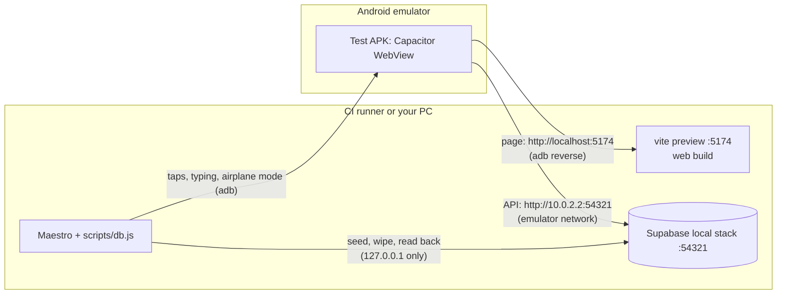

# Android UI tests (Maestro)

The Android app is a Capacitor shell: a native WebView that loads the web app, plus a few native plugins. These flows drive that app on an Android emulator the way a phone user does: taps, typing, the hardware back button, airplane mode, killing and reopening the app. They run against the same throwaway local Supabase stack as the Playwright and API suites, never against the dev or production site.

## What is covered

| Flow | What it proves |
|---|---|
| `01-sign-in` | A fresh install signs in and lands on today's diary with the goal and the four tabs |
| `02-log-food` | A food logged with calories and macros shows its row, the Snacks total, the calories remaining and the macro totals, and is saved exactly once |
| `03-edit-delete-entry` | Doubling the servings doubles the row and the totals and saves 2 servings; deleting through the confirm dialog removes the row from the screen and the server |
| `04-weigh-in` | A weigh-in on the Progress tab shows in the history and is saved once |
| `05-kill-relaunch` | After a force-stop the app reopens signed in, with the day's log and totals intact |
| `06-offline-sync` | In airplane mode a logged food shows at once and waits on the phone ("Offline · 1 pending", nothing on the server); back online it is saved exactly once and shown once |
| `07-back-navigation` | The back button walks back through the tabs; on an unsaved edit it asks first (Keep editing stays, Discard keeps the saved entry); at the root it leaves the app, which reopens intact |
| `08-invalid-login` | A wrong password shows "Invalid login credentials" and stays on the sign-in screen |
| `09-leave-workout` | On a workout with a changed set, the back button asks first ("Leave workout?"): Cancel stays with the edit in place, and Discard changes puts the set back on the server and keeps the workout |

Every flow signs in for itself, so any one can run alone. `scripts/db.js` wipes the test account's diary, weigh-ins and workouts before a flow starts and again when it ends, pass or fail, and every name a flow types carries a run-unique id. `09-leave-workout` has `db.js` start its workout, since adding an exercise in the app puts the picker behind the workout in the back stack. Flows wait on conditions only (`extendedWaitUntil`, Maestro's built-in waits, the app's own "saved" signal), never a fixed delay, and nothing is retried.

## How the test app reaches the test stack



- **A test APK, not the phone's.** The phone's APK loads the dev site. The test APK is the same native shell built with `CAP_SERVER_URL=http://localhost:5174` (read by `capacitor.config.ts`; unset, nothing changes), so it loads a web build served by the host instead. It is uploaded as a run artifact and never published.
- **The page over adb, the API over the emulator's network.** `adb reverse` makes the emulator's `localhost:5174` reach the host's web server; `localhost` counts as a secure context, which the app needs (`crypto.randomUUID` gives every saved row its id). The web build's Supabase URL is `10.0.2.2`, the emulator's address for the host, which goes over the emulated network, so airplane mode really cuts it, while the page itself stays loaded, as an installed app's shell would.
- **A plain Android image.** The emulator runs Android 14's AOSP image, without Google Play Services: on the Google APIs image, Play Services restarting on a fresh boot made Android kill the app (its WebView fonts come from there).
- **Local only.** `db.js` refuses any Supabase URL that isn't `127.0.0.1` or `localhost`, and the account it uses (Kim, `supabase/seed.sql`) belongs to these flows alone.

## Selectors

Maestro reads the screen through Android's accessibility tree, and the WebView puts the web app into it:
- an HTML `id` arrives as the element's resource id (`id: "email"`);
- a button's text is its whole accessible name (`"Snacks + Add"`, `"Oats mh3k2x7 250"`);
- an empty input's label and placeholder arrive as hint text, and a filled input reads as its value then its label (`"3, Servings"`);
- plain text split across elements stays split: a weigh-in row is `"120.2"`, `" "`, `"lb"`, so flows find it by its buttons' labels (`"Delete 120.2 lb"`).

`data-testid` is not exposed, so test ids are plain HTML ids, added only where nothing unique was there already:

| Element | Id |
|---|---|
| Sign-in button (its text is also the card title) | `sign-in-submit` |
| Each meal's add-food button, in both its empty and filled form | `add-food-breakfast`, `-lunch`, `-dinner`, `-snacks` |
| Bottom-nav tabs ("Diary" is also the page heading) | `nav-diary`, `nav-exercise`, `nav-progress`, `nav-more` |
| Progress tab's value field (its label is now linked to it) and its Add button | `measurement-value`, `measurement-add` |

Everything else uses ids the app already had (`email`, `password`, `qa-name`, `qa-kcal`, `qa-p`, `qa-c`, `qa-f`, `srv`) or the text a user reads. A workout's set fields had no label at all, so a screen reader announced a bare number; they now carry one (`Set 1 weight`, `Set 1 reps`, `Set 1 seconds`), and flows find them by it (`"5, Set 1 reps"`). Maestro's DevTools mode (`androidWebViewHierarchy: devtools`) is deliberately not used: it matched the same screen differently from one flow to the next, and Maestro Studio doesn't support it.

**If something is on the screenshot but not in the hierarchy**, the WebView left it out of the accessibility tree, so a screen reader can't reach it either. That was true of the diary entry's "Save changes?" prompt while it rendered inside the page: dialog markup alone didn't fix it, and rendering it in a portal on `<body>`, like the app's other sheets, did. Fix the app, not the selector.

## Running locally

You need an Android emulator (Android Studio → Device Manager → a Pixel with the **API 34 "Android Open Source Project"** image, not a Google APIs or Play Store one), Java 17+, the [Maestro CLI](https://docs.maestro.dev) 2.12.0, and Docker for the local stack. From the repo root in Git Bash:

```bash
npm run db:start
source api-tests/scripts/local-env.sh
VITE_SUPABASE_URL=http://10.0.2.2:54321 VITE_SUPABASE_ANON_KEY=$SUPABASE_ANON_KEY VITE_USDA_API_KEY=x npm run build
npx vite preview --host 127.0.0.1 --port 5174 --strictPort &
```

The `VITE_*` values on the build line take priority over your `.env`, so the build talks to the local stack, not the dev project. Rebuild with your own `.env` before deploying anything by hand.

Get the test APK: download `android-ui-test-apk` from the latest run of the Android UI workflow, or build it (CI builds it because local Gradle builds can hit the Windows AF_UNIX loopback bug):

```bash
CAP_SERVER_URL=http://localhost:5174 npx cap sync android && (cd android && ./gradlew assembleDebug)
```

Start the emulator, then:

```bash
export MAESTRO_SUPABASE_URL=$SUPABASE_URL MAESTRO_SUPABASE_ANON_KEY=$SUPABASE_ANON_KEY
export MAESTRO_FITLOG_EMAIL=kim@e2e.test MAESTRO_FITLOG_PASSWORD=kim-password
APK=path/to/app-debug.apk bash .maestro/ci/run.sh       # all flows; REPEAT=5 for a flake hunt
maestro test .maestro/flows/06-offline-sync.yaml       # one flow (after run.sh has installed the APK and set up adb reverse)
```

Run `npx cap sync android` again without `CAP_SERVER_URL` before building an APK for your phone, or it will look for a server on the phone's own localhost.

## When a flow fails

1. **The run's summary** lists every flow with its passes and the first failing step's message.
2. **Download `android-ui-failure`** from the run. For each run of the set (`run-1/`, …):
   - `output/<flow>/screenshots/` holds a screenshot of the failing step, and `screen-hierarchy/` what Maestro saw at that moment: search it for the text or `resource-id` the step wanted.
   - `debug/<flow>/maestro.log` has every step with timings.
   - `logcat.txt` is the device log: `Capacitor/Console` lines are the web app's console; `Killing <pid>:app.fitlog.mobile` means Android killed the app, and the line says why.
   - `vite-preview.log` shows the web server's side.
3. **Reproduce it locally** with the one flow, then open `maestro studio` to see the live element tree and try selectors against it.

Common causes:

| Symptom | Likely cause |
|---|---|
| A step fails and the screenshot shows the home screen | The app was killed or crashed: look for `Killing` or `FATAL` in `logcat.txt` |
| "Element not found" with the element on the screenshot | Its text in the hierarchy differs from the selector, e.g. a button's text is its whole accessible name. Match the hierarchy, or add an HTML `id`. If it isn't in the hierarchy at all, it is missing from the accessibility tree (see Selectors) |
| "Element not found" for something further down the page | Maestro doesn't scroll on its own: `scrollUntilVisible` first, as a user would |
| A clean launch shows a blank screen | The launch joined the old task while Android was still removing it, and the removal killed it: `logcat.txt` shows `Killing <pid>:app.fitlog.mobile … remove task`, and `run.sh` counts these. Flows go Home, `stopApp`, then `launchApp: clearState`, so no old window is left animating out; keep that order |
| The diary never appears after sign-in | The web build points somewhere else: check the build's `VITE_SUPABASE_URL` and `vite-preview.log` |
| `db.js: sign-in failed` | The stack isn't running, or the seed lacks the Kim account: `npm run db:reset` |
| `06-offline-sync` stuck on "Offline" | The emulator's network didn't come back: `adb shell cmd connectivity airplane-mode disable` |

## What stays manual

Real hardware, real services, or the real phone, so these are checked by hand on the phone: the camera (barcode, label and meal scans, form videos), notifications (the rest-timer banner, meal and streak reminders, the permission prompt), Health Connect steps and weight sync, the Bluetooth heart-rate strap, GPS cardio recording, the biometric lock, and the phone's own WebView, which is newer than the emulator's. The test APK also loads a local build rather than the live dev site, so the live-URL update path is covered by the production canary rather than here.
