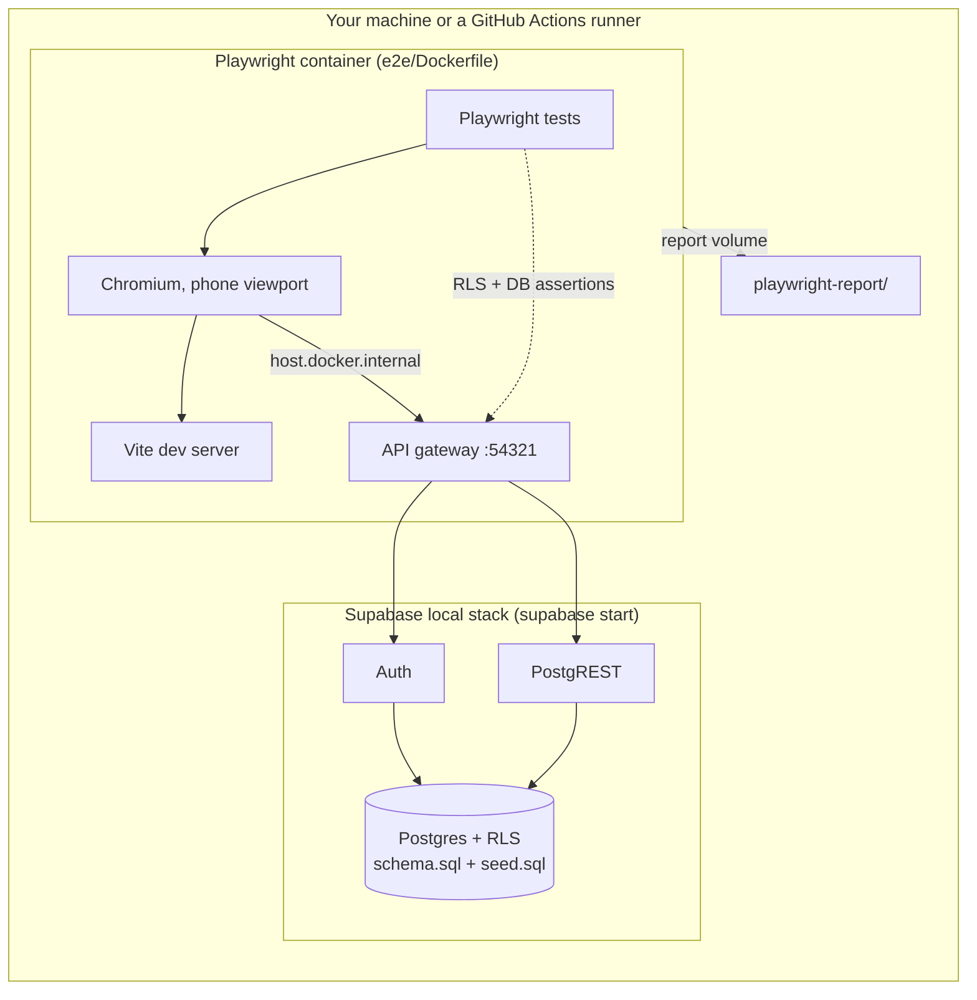
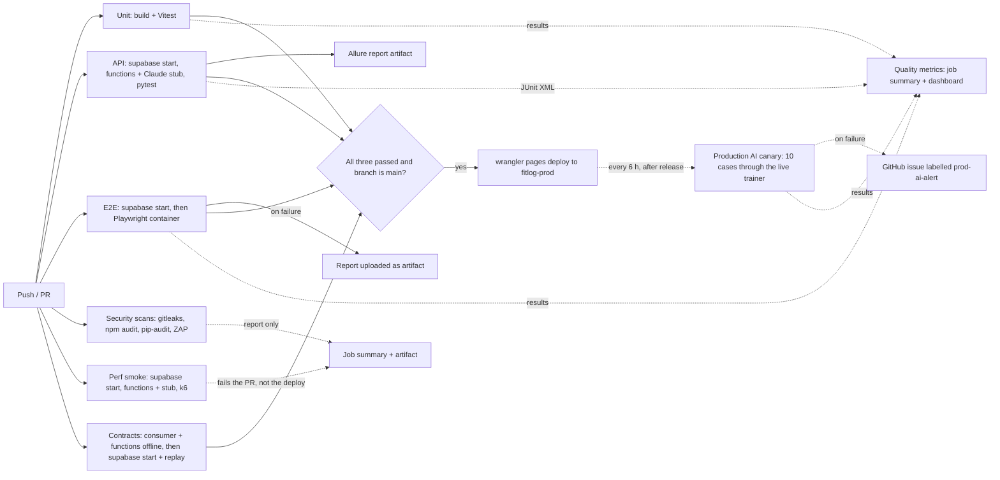

# FitLog

A phone-first Progressive Web App for tracking nutrition, cardio, strength, and body weight — a personal, modern take on the classic MyFitnessPal, built end-to-end with React 19, TypeScript, and Supabase.

**How it is tested:** [TEST-STRATEGY.md](TEST-STRATEGY.md), the test strategy in brief: risks, layers, release gates and known gaps.

**Live app:** [fitlog-9wl.pages.dev](https://fitlog-9wl.pages.dev)

<!-- Add a screenshot or two here — a phone-sized capture of the Diary and Progress views goes a long way. -->

## Overview

FitLog is a single-user, cloud-synced fitness tracker designed mobile-first and installable as a PWA. It covers the full daily loop: logging food against calorie and macro goals, importing whole-food nutrition data from the USDA database, tracking cardio and strength workouts, and charting body-weight and lifting progress over time. The entire stack — data model, business logic, UI, tests, and CI/CD — was designed and built from scratch.

## Features

- **Food diary** with calorie, macro, and full micronutrient tracking (31 nutrients with %DV), plus a live logging streak.
- **USDA food import** — search and import whole-food nutrition data, with automatic per-serving rescaling from the source's per-100g values.
- **Recipes** — build multi-ingredient recipes whose per-serving nutrition is computed and stored automatically.
- **Cardio tracking** — MET-based or distance-based calorie estimates (walk/run/hike) with a manual override, and optional "eat-back" of burned calories.
- **Strength training** — workouts, exercises, and sets with supersets, estimated 1RM (Epley), and per-exercise progression charts (max weight, total volume, average weight per session).
- **Body measurements** — weight plus optional body metrics, with moving-average trend charts.
- **Smart calorie goals** — a hybrid Mifflin-St Jeor BMR × activity model with a deficit derived from a target weekly rate, or a manual override.
- **Installable PWA** with offline read access to recent data.

## Tech Stack

| Layer | Technology |
|---|---|
| Frontend | React 19, Vite, TypeScript |
| Styling | Tailwind CSS v4, small `cva`-based UI primitives (shadcn-style, no CLI) |
| Routing & data | React Router (lazy routes), TanStack Query |
| Backend | Supabase — Postgres + Auth (email/password, magic-link fallback) |
| Charts | Hand-rolled SVG (line charts + macro donut) — no charting library |
| Icons / PWA | lucide-react, vite-plugin-pwa |
| Testing | Vitest (unit), pytest + pytest-bdd + httpx + psycopg (API / database / security), Playwright (E2E, Page Object Model), Allure, Docker + Docker Compose |
| Hosting / CI | Cloudflare Pages, GitHub Actions (tests gate every production deploy) |

## Architecture Highlights

- **Row-Level Security everywhere.** Every table is RLS owner-only, with `user_id` defaulting to `auth.uid()` — access control is enforced in the database, not just the client. Links between tables include the owner too (`(food_id, user_id) → foods(id, user_id)`), so one user's rows can never point at another's.
- **Snapshotting for historical accuracy.** Diary entries snapshot a food's nutrition at log time, so editing a food later never rewrites past days.
- **Feature-based data layer.** TanStack Query hooks are organized per feature with a consistent query-key scheme, and mutations invalidate exactly the keys they affect.
- **Pure, testable core logic.** Calorie/macro math, 1RM, MET calories, BMI, and progression live in dependency-free `src/lib` modules, unit-tested in isolation.
- **Hand-rolled SVG charts** keep the bundle lean and give full control over the mobile-first visualizations.

## Testing

Four layers, each where it is cheapest to prove what it proves:

| Layer | Tool | Size | What it proves |
|---|---|--:|---|
| Unit | [Vitest](https://vitest.dev) | 533 tests, ~10 s | The pure logic: calorie goals, macros, 1RM, progression, dates, nutrients |
| API, database and security | pytest + pytest-bdd ([`api-tests/`](api-tests/README.md)) | 646 tests, ~1 min | Every table is private to its owner (through the API and in Postgres itself), forged tokens are refused everywhere, responses match strict contracts, bad input is refused cleanly, nothing leaks, and the AI functions send and handle exactly what they should |
| Contracts (frontend ↔ API) | Vitest ([`contracts/`](#contract-tests)) | 24 interactions, 61 checks, ~10 s + the local stack | The requests the app really sends and the fields it really reads, recorded from the app's own code and replayed against the Pages Functions in-process and against PostgREST + Auth live: a renamed field, a changed type or a removed endpoint the frontend depends on fails by name |
| AI trainer evals | pytest ([`ai-evals/`](ai-evals/README.md)) | 264 tests, ~2 min; live tier on demand; production canary every 6 h | The Ask-a-trainer chat's guardrails against prompt injection, information exposure, unintended actions and a failing Claude, with Claude replaced by a stub (every push); the real model's behaviour on 87 cases x 3 runs, including fairness (counterfactual name, age and sex pairs scored for equivalence, and stated dietary and religious constraints), judged where rules can't decide (by hand, capped at a few dollars); and a canary of ten cases through the deployed production trainer every six hours, with a latency budget and GitHub-issue alerts |
| End to end | Playwright ([`e2e/`](e2e/README.md)) | key journeys, a few minutes | The real app, in a phone-sized browser, against a real database |
| Performance | k6 ([`perf-tests/`](perf-tests/README.md)) | smoke on every PR (~2 min); load + soak nightly; stress and spike by hand | The backend holds its latency and error budgets under realistic user journeys at expected load, degrades predictably past it, and doesn't drift over a long run |

One command runs them all, bottom of the pyramid first, stopping at the first failing layer:

```bash
make test          # or, without make: bash scripts/test-all.sh test
```

| Command | Runs |
|---|---|
| `make stack-up` / `make stack-down` | The local Supabase stack in Docker (shared by the API and E2E suites) |
| `make test-unit` | Vitest (`npm test`; `npm run test:watch` while iterating) |
| `make test-contracts` | Contract tests: consumer + Pages Functions offline (`npm run test:contracts`), then PostgREST + Auth against the local stack (`npm run test:contracts:supabase`) |
| `make test-api` | The API suite, with JUnit XML and Allure results in `reports/` |
| `make test-ai` | The AI trainer evals, tier 1 (deterministic, no API key) |
| `make eval-ai-live` | The AI trainer evals, tier 2: the real Claude API, capped (needs a key; see `ai-evals/README.md`) |
| `make canary-prod` | The production AI canary once, by hand: ten cases through the deployed trainer, capped at $0.25 (needs `ai-evals/.env.canary`; see `ai-evals/README.md`) |
| `make test-e2e` | Playwright, in its container |
| `make test-security` | Security scans: gitleaks, npm audit, pip-audit and an OWASP ZAP baseline scan (report only) |
| `make report` | Builds and opens the Allure report of the last API and AI-eval runs |
| `make perf-smoke` / `perf-load` / `perf-stress` / `perf-soak` | The k6 scenarios against the local stack (see Performance tests); `make perf-clean` removes a stopped run's users |

A `tsc + vite` build check is run before every commit to keep the tree type-safe. Security issues the suites and scans have found, and how each was fixed, are tracked in [`SECURITY-FINDINGS.md`](SECURITY-FINDINGS.md); what the AI trainer evals found is in [`AI-SAFETY-FINDINGS.md`](AI-SAFETY-FINDINGS.md).

### Contract tests

The frontend talks to two providers it does not deploy with: Supabase (PostgREST and Auth, called straight from the browser with supabase-js) and four Cloudflare Pages Functions under `/api/*`. The unit tests can't see that boundary and the E2E suite only sees it through the screen, so [`contracts/`](contracts) holds **consumer-driven contract tests** that pin it down from the app's side.

**How it works.** The consumer tests (`contracts/consumer/`) run the app's own code — `signInWithPassword`, the diary's TanStack mutations, `fetchDiaryDay`, `askTrainer`, `scanPlate` — against a recording stand-in for the provider. Each test states the request the app must make and an example answer, then checks the app sent exactly that and read the example correctly. The recorded interactions are written to two reviewable files, `contracts/fitlog-web--supabase.json` and `contracts/fitlog-web--pages-functions.json`: the request as sent (secrets as `{{placeholders}}`), the status, the response fields the app reads as a JSON Schema, and the provider states each needs. The provider verifications then replay those files:

- `contracts/provider/functions.verify.test.ts` calls the real handlers in `functions/api/` in-process, with the sign-in check and the Claude API scripted from the provider states (no wrangler, no network, milliseconds).
- `contracts/provider/supabase.verify.test.ts` reads PostgREST's OpenAPI description of the live local database and checks every column the app reads or writes still exists with a compatible type and nullability, then sends each recorded request for real as a user created for the run and validates the answer. It refuses any URL that isn't the local stack.

**What's covered** (24 interactions): sign-in and the 400 the login page shows; the current user; logging a food (and the 409 duplicate case the offline queue relies on); reading a day; editing servings, editing an entry, deleting one and several; the three reads behind the daily summary (entries, cardio calories, profile) and the profile update; the Ask-a-trainer stream with its 400/401/502/503; the meal-photo scan with its 400/401/422/503.

```bash
npm run test:contracts            # consumer tests + Pages Functions verification, offline, ~10 s
npm run db:start                  # once; then point the Supabase half at it:
source api-tests/scripts/local-env.sh && npm run test:contracts:supabase
make test-contracts               # both halves
```

**When it fails.** The message names the interaction, the route and the field. A *provider* verification failure means the API or the database no longer gives the frontend what it reads: fix the provider (or the schema), or, if the change is intended, change the frontend and its consumer test together. A *consumer* test failure saying the contract file is out of date means the app's needs changed: review the diff with `npm run contracts:update`, commit the new file, and run both provider verifications against it. Never edit the `.json` files by hand; they are generated.

### End-to-end tests in Docker

The E2E suite ([`e2e/`](e2e/README.md)) drives the real app in Chromium at a phone viewport through the key user journeys (sign in, log a meal, search and add foods including a stubbed USDA import, build and log recipes, create and start workout templates, run a program rotation, log cardio and record a GPS walk with a fake GPS, edit and delete entries, create foods, set profile goals and macros, save meals and copy days, ask the AI trainer (stubbed), export and restore a backup, log a workout, log body weight). It also checks Row-Level Security directly against the database API. Everything runs in containers:

- **Test database:** the Supabase CLI's local stack (Postgres, Auth, PostgREST and Storage in Docker), built from the same `supabase/schema.sql` as production, including its RLS policies. `supabase/seed.sql` adds two test users. Tests never touch a hosted project, and `e2e/support/env.ts` refuses to run against any non-local URL.
- **Test runner:** Microsoft's official Playwright image, pinned to the exact `@playwright/test` version (`e2e/Dockerfile`). It runs the Vite dev server and the browser inside the container.

With Docker running, one command runs the whole suite:

```bash
npm run test:e2e:docker   # start the test DB, build the runner image, run all tests
```

The HTML report lands in `playwright-report/` on your machine (`npx playwright show-report`). Stop the database with `npm run db:stop`, or restore it to the seed state with `npm run db:reset`.



### Performance tests

[`perf-tests/`](perf-tests/README.md) is a small k6 framework (TypeScript, no bundler) that replays FitLog's real user journeys — open the diary, search for and log a meal, log a workout set by set, log a weigh-in, ask the trainer — against the same disposable local stack, with think time between actions and per-run users seeded with months of history. Four scenarios share one journey mix: **smoke** (2 users, a minute; gates every PR), **load** (30 users, 5 minutes steady), **stress** and **spike** (up to 300 users, report-only: where does it break?) and **soak** (expected load held for an hour, with a drift check). Latency and error budgets are set per endpoint group with a written rationale, a breach fails the run, and every run's headline numbers (p95/p99, error rate, throughput, which budgets held) go to the quality dashboard's Performance section. It refuses to run against anything but the local stack, stubs Claude, never reaches USDA, and deletes its users afterwards.

```bash
make perf-smoke     # ~2 min; make perf-load, perf-stress, perf-soak (SOAK_DURATION=10m to shorten)
```

### CI/CD pipeline

[`.github/workflows/ci.yml`](.github/workflows/ci.yml) runs on every pull request and every push to `dev` or `main`:



Production is only deployed from `main`, and only after the unit, API, E2E and contract jobs all pass. The API job runs in parallel with E2E on its own runner, so it adds no time to a release. The security scans and the metrics job report on every run but are deliberately outside the release gate: findings are reviewed and fixed as their own changes, not by blocking a deploy. The performance smoke job fails a PR's checks but is not a `deploy-prod` dependency. The `dev` site still auto-deploys through Cloudflare's Git integration.

A second workflow, [`perf.yml`](.github/workflows/perf.yml), runs the load scenario and a 10-minute soak against `dev` every night and publishes their headline numbers to the dashboard; by hand it runs any scenario (stress, spike, a long soak) on any branch.

After a release the [production AI canary](.github/workflows/prod-canary.yml) keeps watching: every six hours it sends ten of the trainer evals' cases through the live production trainer as a dedicated monitor account, and opens a GitHub issue labelled `prod-ai-alert` (one for the endpoint erroring or slowing past its p95 budget, another for answers below the quality bar) that it closes itself when a later run recovers. It is a monitor, not a gate: it cannot block a deploy, writes nothing in production, and refuses to run if a run could cost more than $0.25. Details and set-up in [`ai-evals/README.md`](ai-evals/README.md#production-canary-shift-right).

### Quality metrics dashboard

**Live dashboard: [kakaul94-prof.github.io/FitLog](https://kakaul94-prof.github.io/FitLog/)**

Every CI run records its results so quality can be tracked over time, not just pass/fail per build.

| Tracked | How |
|---|---|
| Pass rate per suite | Unit, API and E2E: tests that passed (including after a retry) ÷ tests run, per CI run |
| Feedback time | From the push (or PR update) until every suite's results are in |
| Flaky rate + top flaky tests | Tests that failed, then passed on a retry; ranked by how often across runs |
| Suite duration + slowest 10 tests | Wall-clock time per suite; each slow test against its own 10-run average |
| Last run status | Result, branch, commit link and per-job outcome, including infrastructure failures with no test results |
| AI evals, live tier | Rule-check pass rate per category, cost, p50/p95 latency per run and per category against its budget (informative), and the fairness groups' parity |
| Production canary | Pass rate, calls answered, p50/p95 latency and estimated cost per run through the live production trainer, every six hours, with the open-alert status read live from GitHub |

**How flaky detection works.** In CI Playwright retries a failing test up to twice. Playwright then marks a test that failed and later passed as `flaky`, and the metrics keep that status rather than counting it as a pass. Retries keep a release from being blocked by a one-off timing problem without hiding it, and the dashboard shows which tests rely on them. Unit tests run with no retries on purpose, because they should be deterministic. For flakes rare enough to slip past retries, the manual [Flake hunt](.github/workflows/flake-hunt.yml) workflow runs every E2E test N times with retries off and ranks tests by failure rate.

**How it's built** ([`metrics/`](metrics)):

1. Playwright and Vitest each write a JSON report and the API suite writes JUnit XML, next to their usual output, and each job uploads it as an artifact, even when tests fail.
2. A `metrics` job turns the reports into one record per run (timestamp, commit, branch, totals, durations, per-test times) and writes a results table to the run's job summary, PRs included. One small adapter per tool maps its report into a shared shape, so adding a new tool means adding one adapter (`metrics/adapters/`).
3. On pushes to `main` and `dev`, the record is appended to `data/history.json` on the `gh-pages` branch (capped at 200 runs, ~0.6 MB), which GitHub Pages serves with a static Chart.js page. Git acts as the database, so there is no server and no paid service, and history is versioned. The alternative was deploying the page as a build artifact and re-downloading the previous history each time. That avoids bot commits, but one failed download would wipe the history.

The `metrics` job is outside the release gate: `deploy-prod` depends only on the three test jobs, the metrics job has `continue-on-error`, and it runs alongside the deploy. A metrics failure can't block or slow a release. Records contain test names, statuses, durations and public run links only; no error text, logs or environment values are published.

## Getting Started

### Prerequisites

- Node.js 20.19+ (Vite 8)
- Docker Desktop (for the API and E2E suites)
- Python 3.12+ (for the API suite)
- A [Supabase](https://supabase.com) project (Postgres + Auth)
- A [USDA FoodData Central](https://fdc.nal.usda.gov/api-key-signup.html) API key (for food import)

### Setup

```bash
# 1. Clone and install
git clone https://github.com/kakaul94-prof/FitLog.git
cd FitLog
npm install

# 2. Configure environment (create a .env file)
cp .env.example .env   # then fill in the values below
```

```env
VITE_SUPABASE_URL=your-supabase-url
VITE_SUPABASE_ANON_KEY=your-supabase-anon-key
VITE_USDA_API_KEY=your-usda-api-key
```

```bash
# 3. Apply the database schema
#    Run supabase/schema.sql in the Supabase SQL Editor (it's idempotent)

# 4. Run it
npm run dev       # http://localhost:5173
```

### Scripts

| Command | Description |
|---|---|
| `npm run dev` | Start the dev server |
| `npm run build` | Type-check and build for production (`tsc` + `vite`) |
| `npm test` | Run the unit test suite |
| `npm run test:watch` | Run tests in watch mode |
| `npm run test:e2e:docker` | Start the local test DB and run the E2E suite in Docker |
| `npm run test:e2e` | Run the E2E suite on the host (needs `npm run db:start`) |
| `npm run db:start` / `db:stop` / `db:reset` | Manage the local Supabase test stack |
| `make test` / `test-api` / `test-ai` / `test-security` / `report` | Every test layer, the API suite, the AI evals, the security scans, the Allure report (see Testing) |
| `make perf-smoke` / `perf-load` / `perf-stress` / `perf-soak` / `perf-clean` | The k6 performance scenarios (see Performance tests) |

## Deployment

FitLog deploys to **Cloudflare Pages**. The `dev` branch auto-deploys to the dev site through Cloudflare's Git integration. Production (`fitlog-prod`) is deployed by the CI workflow's `deploy-prod` job with `wrangler pages deploy`, only after the unit, API and E2E jobs pass on `main`. SPA deep links are handled via `public/_redirects`.

The deploy job reads these GitHub repository secrets and skips itself until `CLOUDFLARE_API_TOKEN` exists:

| Secret | Value |
|---|---|
| `CLOUDFLARE_API_TOKEN` | Cloudflare API token with the *Cloudflare Pages: Edit* permission |
| `CLOUDFLARE_ACCOUNT_ID` | Cloudflare account ID |
| `PROD_VITE_SUPABASE_URL` / `PROD_VITE_SUPABASE_ANON_KEY` / `PROD_VITE_USDA_API_KEY` | The production build variables (the same values set in the `fitlog-prod` Pages project) |

Once the secrets are set, turn off automatic production deployments for `fitlog-prod` in Cloudflare (Settings → Build → Branch control), so the gated CI job is the only way to production.

## Project Structure

```
src/
├── pages/         # one component per route
├── features/      # TanStack Query hooks, grouped by domain area
├── lib/           # pure logic: calc, nutrients, progression, date, supabase client
├── components/    # UI primitives + layout (AppLayout, BottomNav, shared panels)
└── data/          # built-in activities & exercises
supabase/
├── schema.sql     # idempotent schema + RLS policies
├── seed.sql       # E2E test users + data (local stack only)
└── config.toml    # Supabase CLI local stack
e2e/
├── Dockerfile     # Playwright runner image
├── pages/         # Page Objects
├── tests/         # user-journey specs + RLS spec
└── support/       # local-only env guard, Supabase API client
testkit/           # shared Python package (fitlog-testkit): clients, token forger, factories, contracts, Claude stub
api-tests/
├── tests/         # auth, authz, contracts, validation, security, functions, bdd
└── scripts/       # local-env.sh, start-functions.sh
ai-evals/
├── dataset/       # personas + 68 eval cases (YAML), rubrics/, calibration/
├── canary/        # the production canary's ten cases + snapshot fixture
├── harness/       # the app's own trainer code, bundled for Node
├── aievals/       # checks, judge, proxy, live runner, canary + alerts, calibration
└── tests/         # tier 1: injection, exposure, actions, output, failures, canary, alerts
perf-tests/
├── config/        # scenario profiles (VUs, durations, seed), budgets + thresholds, endpoint registry
├── lib/           # local-only guard, PostgREST request builder, auth, seeding, journey mix, summary
├── journeys/      # viewDiary, logMeal, logWorkout, logWeight, askTrainer + the weighted mix
├── scenarios/     # smoke, load, stress, spike, soak (a few lines each)
└── run.sh         # stack guard → functions + stub → k6 (native or Docker) → verdict → clean-up
metrics/           # CI quality metrics, performance history + security-scan summary
scripts/           # test-all.sh (behind the Makefile), security-scan.sh
compose.yaml       # `e2e` service (docker compose run e2e)
Makefile           # make test, test-api, test-ai, eval-ai-live, canary-prod, test-security, report, perf-* ...
```

## Notes

FitLog is a personal project, built and maintained solo. The Supabase anon key is safe to expose in the client because access is fully governed by Row-Level Security policies.
